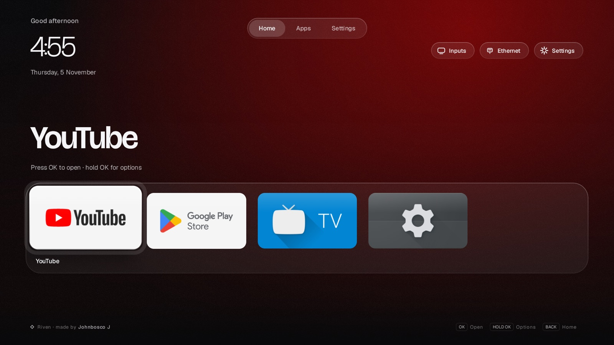
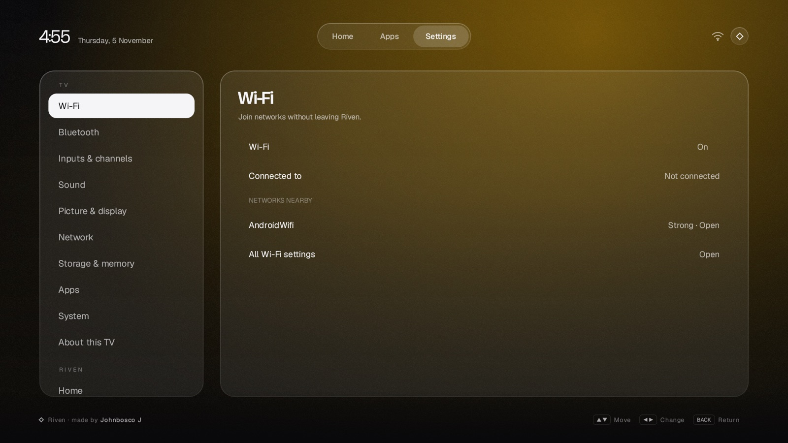
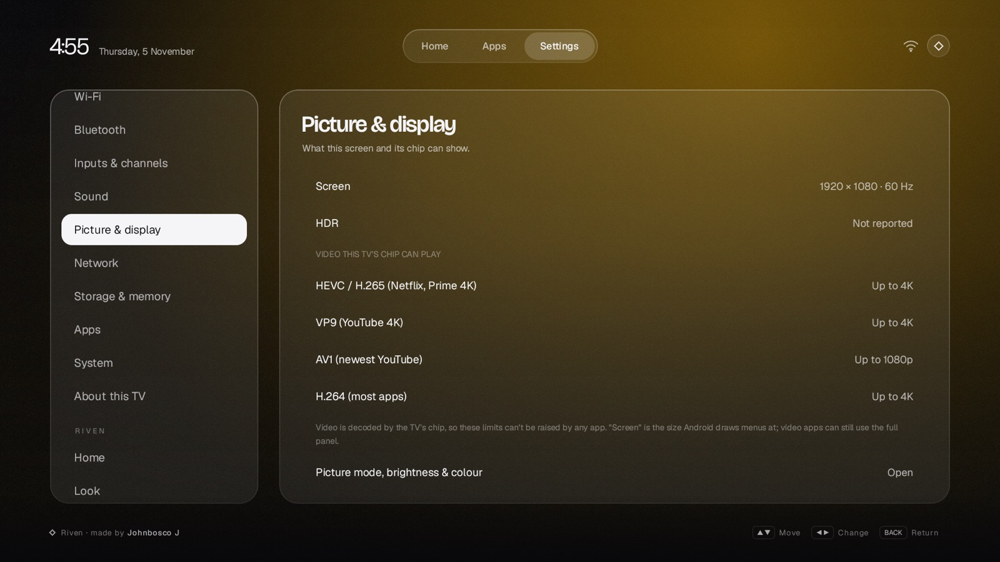
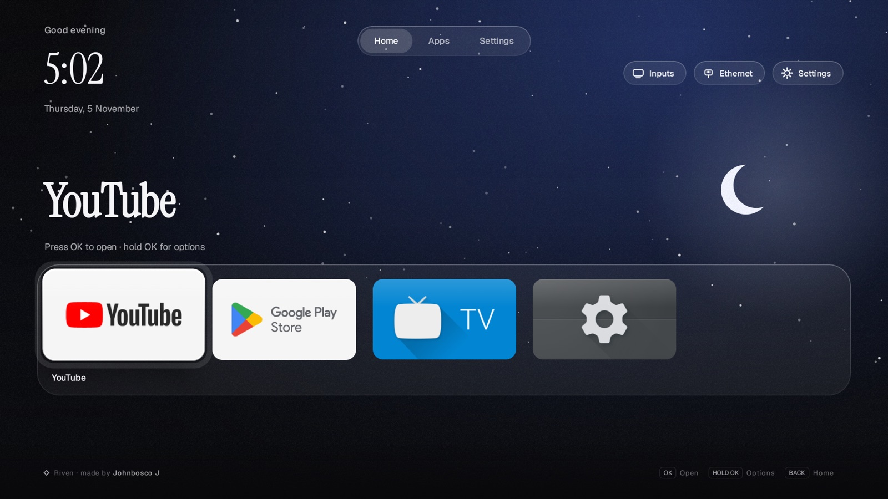
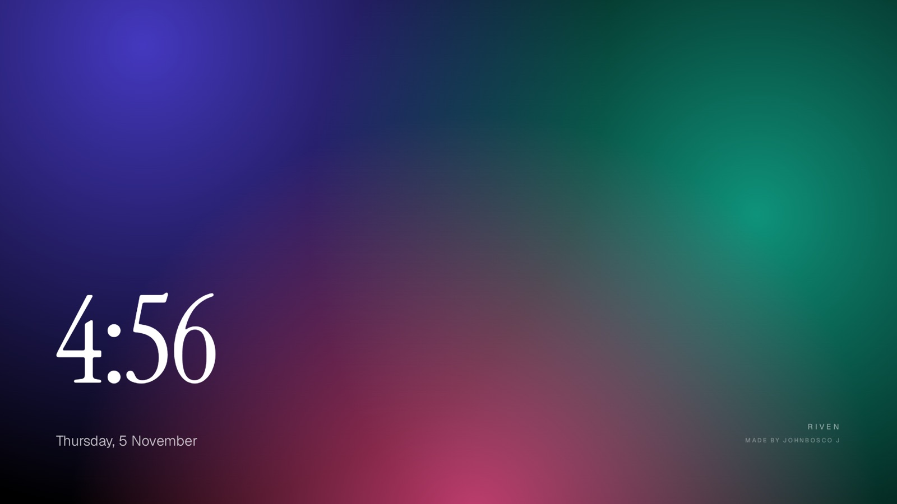

<p align="center">
  
</p>

<h1 align="center">Riven TV</h1>
<p align="center"><b>A calm, fast home screen for Android TV and Google TV.</b><br>
No ads, no sponsored rows. Your apps in full colour, a frosted dock, and Riven's own screens for Wi‑Fi, Bluetooth, sound and the rest.</p>

<p align="center">
  <a href="https://github.com/johnbosco-j/riven-tv/releases/latest"><b>Download the latest APK</b></a> ·
  <a href="https://rivendevs-site.vercel.app/tv">Product page</a> ·
  Made by Riven · designed and built by Johnbosco J
</p>

---

## What you get

| | |
|---|---|
| **Home** | Greeting, thin clock and date · the focused app's name in large type over a glow in its colour · a frosted dock of your first apps · every other app in a grid that slides up · one glass highlight that springs from tile to tile. |
| **Your apps, your order** | Every installed app appears, in full colour (each app's own TV banner). Hold OK for Open · Move · Remove · Hide · App info · Uninstall. |
| **Install queue** | Start an install in Play Store and it waits on Home with a progress ring, then lands as a normal tile with a NEW badge. |
| **Riven Settings** | Wi‑Fi (scan, join with a password, on/off) · Bluetooth (find, pair, unpair) · Inputs & channels · Sound · Picture & display (with what video your TV's chip can decode, up to 1080p/4K/8K and HDR) · Network · Storage & memory (with **Free up memory**) · Apps · System · About this TV. |
| **Make it yours** | Seven backgrounds including *follows the focused app* and *Night sky* · seven Google Fonts pairings · colour or monochrome icons · dock size · card size · **Effects: Full / Balanced / Lightest** for older TVs. |
| **Remote buttons** | Source → Inputs · Menu → app options · Info → Settings · Guide → Live TV · 1–9 → open that app · 0 → All apps · Exit → back · four colour keys you assign · built-in key tester. |
| **Screensaver** | *Riven Ambient*: Aurora, Clock or Showcase. Starts by itself when the remote is idle; the clock drifts so nothing burns in. |
| **Home button** | Takes over the remote's Home button without root, through an optional accessibility service. |

<p align="center">
  
  
  
  
</p>

## Install

Riven runs on **Android TV 8.0 and newer** and on **Google TV**.

### From a pen drive (no computer tools needed)
1. Download `Riven.apk` from [Releases](https://github.com/johnbosco-j/riven-tv/releases/latest) and copy it to a USB drive (FAT32).
2. On the TV, install a file manager from Play Store (for example *X-plore*), allow it under
   Settings → Device Preferences → Security & restrictions → Unknown sources.
3. Open the drive in the file manager → `Riven.apk` → Install → Open.
4. Press **Set as Home** at the top right of Riven and turn on **Riven Home button**.

### Over Wi‑Fi with ADB (also removes bloat)
Turn on USB debugging (Settings → About → press OK on *Build* seven times → Developer options).
Then, with the APK saved as `Riven.apk` in this folder:
```bash
cd scripts
./riven.sh setup <tv-ip>        # connect, back up, install, make Home, screensaver, faster animations
./riven.sh debloat              # dry run; add --apply to disable bloat (reversible)
./riven.sh restore              # undo everything
```
Every change is a `pm disable-user` (never an uninstall) and is logged, so `restore` puts the TV back.

## Build

Needs JDK 17–21 and Android SDK 35.
```bash
cd launcher
./gradlew assembleFullRelease   # app/build/outputs/apk/full/release/app-full-release.apk
./gradlew assembleLiteRelease   # same app without the Home-button accessibility service
```
Kotlin + Jetpack Compose. Laid out on a 960×540 dp canvas and scaled to the panel. Tested on an
Android 8 emulator, a Google TV 14 emulator and a Thomson 65OATH7000 (Android TV 8, Mali‑T860).

| Where | What |
|---|---|
| `Home.kt` | Home screen, dock, grid, glass highlight |
| `SystemPanels.kt` | Wi‑Fi, Bluetooth, Sound, Display, Network, Storage, Apps, System, About |
| `Customize.kt` | Settings tab and Riven's own options |
| `Apps.kt` | App list, install sessions, inputs, memory |
| `Theme.kt` | Colours, fonts, the cached background |
| `RivenKeyService.kt` | Optional Home-button takeover |
| `Ambient.kt`, `RivenDream.kt` | Screensaver |

## Honest limits

- A launcher can't replace Android itself; that needs an unlocked bootloader. Riven is the layer you see and touch.
- Video decoding is done by your TV's chip. Riven shows the limits (Settings → Picture & display) but can't raise them; no app can add 8K to a 4K TV.
- Date, language, factory reset and picture modes need system permission, so those rows open the TV's own screens.

## Credits

Made by **Riven** · designed and built by **Johnbosco J**.
Thomson debloat list and the keycode‑83 Settings button come from [CleanYourTV](https://github.com/Gathin23/cleanyourtv) (MIT).
Fonts: Bricolage Grotesque, Geist, Instrument Serif, Fraunces, Unbounded, Space Grotesk, Syne, Manrope, Outfit (Google Fonts, OFL).
Not affiliated with Google, Apple or Thomson.

MIT licensed.
